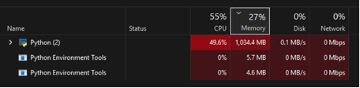
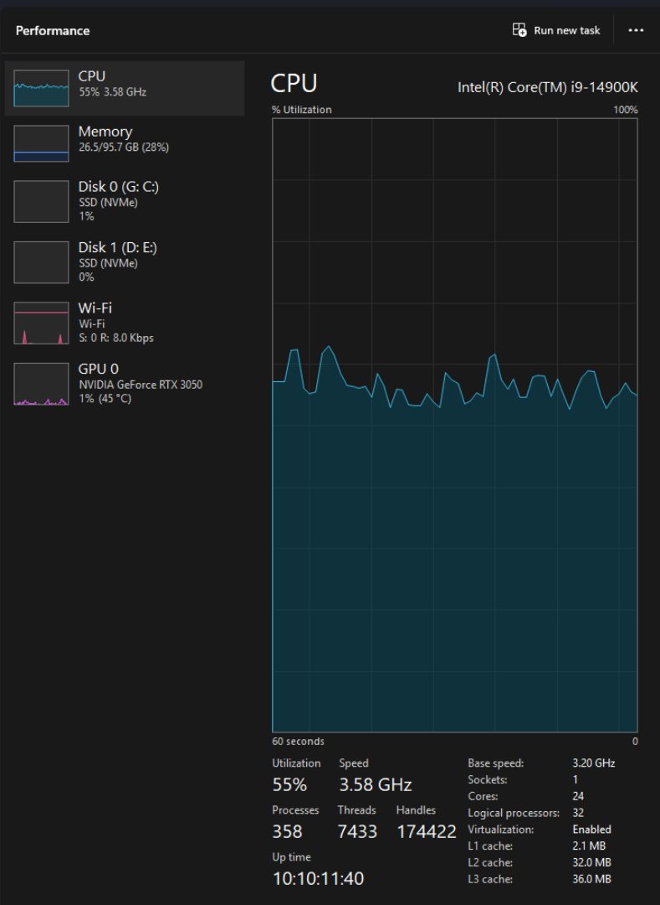
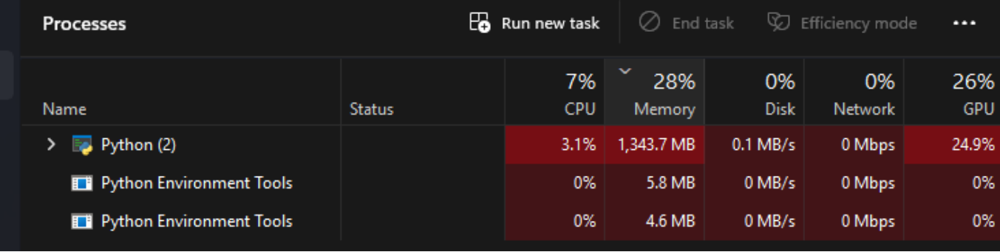
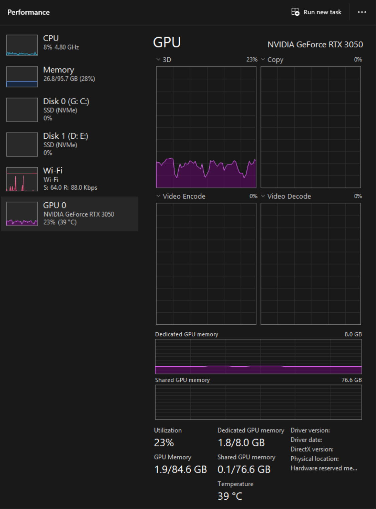
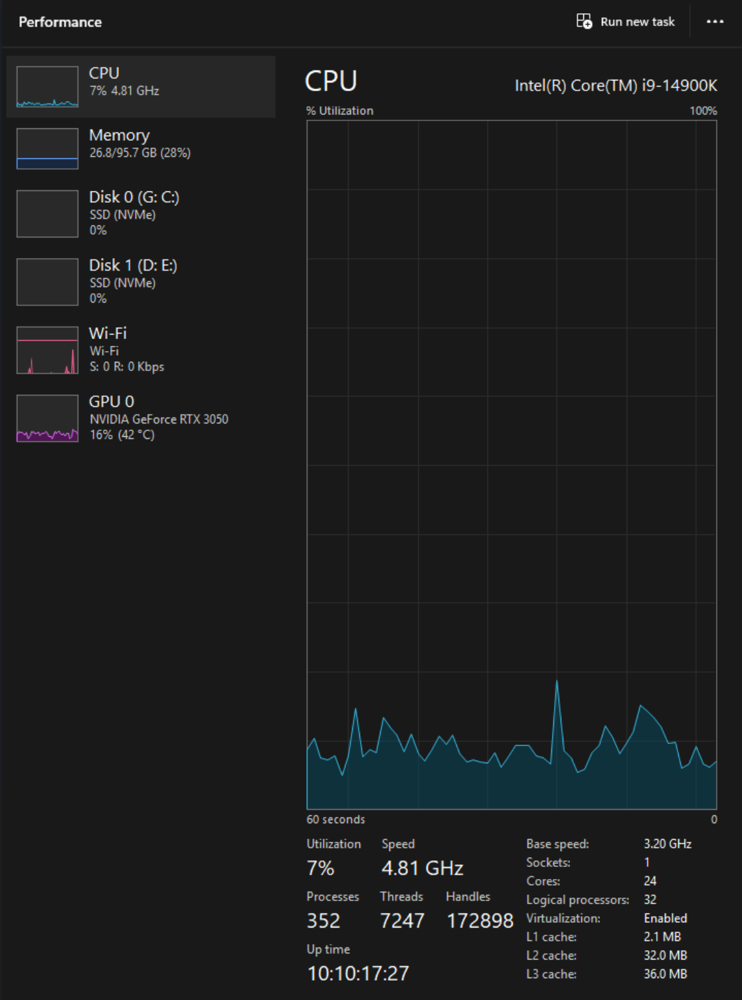
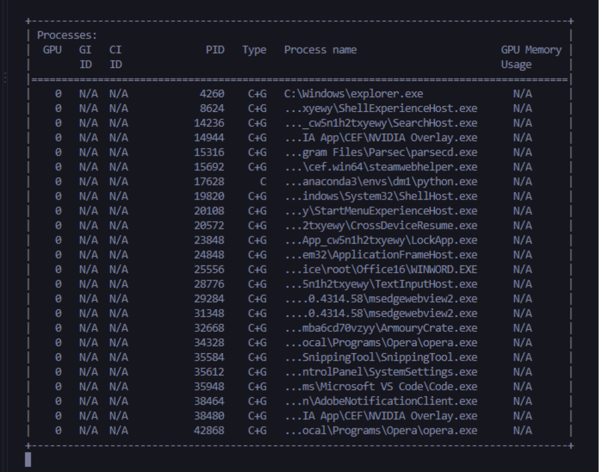

# Proyecto 3: Mejorando algoritmos con CUDA

## Reconocimiento de señas ASL con CPU y GPU
 `results_fast/raw/e8ad82b8761d`  


+ Francisco Martínez 23617
+ Sebastián García 22291
+ Ana Laura Tschen 221645


## 1. Resumen

Se refactorizó la CNN básica del Laboratorio 3 de Data Science para separar la preparación de imágenes, que permanece en CPU, del entrenamiento de la red neuronal, que se ejecuta en CPU o CUDA según el backend seleccionado. La corrida real utilizó 87,000 imágenes del dataset ASL Alphabet, 29 clases y particiones congeladas. Con cinco repeticiones por backend, CUDA redujo el tiempo total promedio de `177.46 s` a `97.59 s`, equivalente a un speedup de `1.82x` y una reducción de `45.01%`.

## 2. Objetivo

Medir el efecto de trasladar a GPU las operaciones matemáticas intensivas de la CNN, manteniendo en CPU la lectura de archivos JPEG, la conversión RGB, el resize y la normalización. La comparación se hizo con los mismos datos, semilla, modelo, hiperparámetros y máquina.

## 3. Solución secuencial y operaciones repetitivas

| Operación | Funcionamiento |
|---|---|
| Enumeración | Los manifests identifican cada archivo y su clase. |
| Lectura | `PIL.Image` abre cada JPEG en CPU y lo convierte a RGB. |
| Resize | `torch.nn.functional.interpolate` cambia la imagen a 64x64 en CPU. |
| Normalización | La imagen se convierte a float32 y se divide entre 255. |
| Formación de lotes | `DataLoader` construye lotes de 64 muestras. |
| Transferencia | En CUDA, entradas y etiquetas se copian de CPU a `cuda:0`. |
| CNN | Conv2D, ReLU, MaxPool, Dense, loss, gradientes y Adam. |
| Evaluación | Se calculan loss y accuracy en validation y test. |
| Evidencia | Se guardan metadata, CSV, historial por época, checkpoints y muestras de uso. |

| Operación repetitiva | Datos | Repeticiones por corrida |
|---|---:|---:|
| Preprocesamiento train | 12,180 imágenes | 5 épocas |
| Forward/backward/Adam | 191 lotes por época | 955 lotes |
| Validación | 2,610 imágenes por época | 5 veces |
| Test | 2,610 imágenes | 1 vez |
| Corridas completas | Mismo protocolo | 5 CPU + 5 CUDA |

## 4. Diseño paralelo

El lote es la unidad de trabajo. PyTorch y cuDNN distribuyen las convoluciones, activaciones y productos matriciales mediante kernels CUDA sobre grids, bloques e hilos administrados por la biblioteca.

| Fase | CPU | GPU |
|---|---:|---:|
| Lectura de archivos/JPEG | Sí | No |
| Resize y normalización | Sí | No |
| Copia H2D | Origen | Destino |
| Conv2D/ReLU/MaxPool | No | Sí |
| Dense, loss, gradientes y Adam | No | Sí |
| Métricas | Preparación/lectura final | Cálculo de tensores |

La implementación usa PyTorch CUDA (`.to('cuda:0')`, cuDNN y kernels de PyTorch). No se implementaron kernels manuales con Numba o CUDA C++; si el docente exige kernels escritos por el equipo, esto debe confirmarse o ampliarse.

## 5. Protocolo experimental

- Dataset: ASL Alphabet, 29 clases y 87,000 imágenes.
- Particiones: train `12,180`, validation `2,610`, test `2,610`.
- Entrada: RGB, 64x64, float32, normalización `/255`.
- Arquitectura: CNN básica, `2,120,413` parámetros.
- Batch size: `64`.
- Épocas: `5`.
- Repeticiones: `5` por backend.
- Learning rate: `0.001`.
- CPU: 16 hilos, `num_workers=0`.
- CUDA: NVIDIA GeForce RTX 3050, memoria reportada por PyTorch `204.29 MB`.
- PyTorch: `2.14.0+cu126`.
- Sistema: Windows 11, 32 hilos lógicos y aproximadamente 95.7 GB RAM.

CPU y CUDA se ejecutaron secuencialmente en la misma máquina. Ejecutarlas simultáneamente habría contaminado la comparación por competencia por CPU, disco, RAM y GPU.

## 6. Resultados

### 6.1 Resumen por backend

| Backend | Tiempo total medio (s) | Desv. estándar (s) | Loss | Accuracy |
|---|---:|---:|---:|---:|
| CPU | 177.463 | 12.713 | 0.5178 | 85.13% |
| CUDA | 97.592 | 2.938 | 0.4387 | 87.66% |

### 6.2 Tiempo por fase

| Fase | CPU medio (s) | CUDA medio (s) | Speedup | Reducción |
|---|---:|---:|---:|---:|
| Preprocess | 89.721 | 76.727 | 1.17x | 14.48% |
| Train | 80.102 | 17.879 | 4.48x | 77.68% |
| Eval | 7.505 | 1.576 | 4.76x | 79.00% |
| Total | 177.463 | 97.592 | 1.82x | 45.01% |

CUDA registró además:

| Métrica | Media |
|---|---:|
| H2D | 1.203 s |
| D2H | 0.0047 s |
| Cómputo GPU medido por CUDA Events | 17.728 s |
| Memoria GPU pico | 204.29 MB |

El speedup total es menor que el speedup de entrenamiento porque el preprocessing continúa en CPU y representa la mayor parte del tiempo CUDA: aproximadamente 76.7 s.

## 7. Evidencia de ejecución

### CPU





### CUDA









Las capturas de Task Manager muestran el proceso Python y actividad GPU durante la ejecución. En Windows WDDM, algunas versiones de `nvidia-smi` pueden mostrar `N/A` en memoria por proceso aunque la GPU esté siendo utilizada; por eso la evidencia se complementa con Task Manager, los CSV del monitor y `peak_gpu_mem_mb` registrado por PyTorch.

Los datos originales están en [results_fast/screenshots](../results_fast/screenshots). Los CSV y metadata están en [results_fast/raw/e8ad82b8761d](../results_fast/raw/e8ad82b8761d).

## 8. Discusión técnica

### ¿Por qué dejar los archivos en CPU?

La lectura de JPEG, acceso al sistema de archivos y conversión de imágenes son operaciones dominadas por I/O y llamadas de biblioteca. Mover cada archivo individual a GPU añadiría transferencias y lanzamientos de kernels pequeños, sin garantizar una mejora. Por eso el pipeline prepara lotes en CPU y copia únicamente los tensores necesarios.

### ¿Qué aceleró CUDA?

Las convoluciones, productos matriciales, activaciones, loss y gradientes tienen paralelismo sobre muestras, canales y posiciones espaciales. CUDA permite procesar muchos elementos simultáneamente. El entrenamiento bajó de `80.10 s` a `17.88 s`, un speedup de `4.48x`.

### ¿Por qué el total no mejora 4.48x?

El límite principal es el preprocessing CPU, que consume `89.72 s` en CPU y `76.73 s` en CUDA. También existen costos de transferencia H2D, inicialización, sincronización, lanzamientos de kernels y evaluación. Esta es la razón por la que el speedup total es `1.82x`.

### Factores que limitan CUDA

- El batch y el modelo no son suficientemente grandes para saturar siempre la GPU.
- La lectura y el resize ocurren antes de las operaciones GPU.
- Las sincronizaciones necesarias para medir fases reducen el solapamiento posible.
- La GPU usada es una RTX 3050 con 8 GB y el experimento busca reproducibilidad, no máximo throughput.
- La comparación usa PyTorch CUDA; no representa una implementación de kernels manuales.

## 9. Reproducibilidad

```powershell
conda activate dm1
python scripts/benchmark.py --config configs/benchmark_fast.yaml --devices cpu cuda --repeats 5
```

Archivos principales:

- [Configuración rápida](../configs/benchmark_fast.yaml)
- [Tabla de resumen](../results_fast/raw/e8ad82b8761d/analysis/summary.csv)
- [Tabla de speedup](../results_fast/raw/e8ad82b8761d/analysis/speedup.csv)
- [Informe PDF](../report/informe_rendimiento.pdf)

## 10. Conclusiones

La refactorización cumple la separación solicitada: CPU para preparación de datos y CUDA para la matemática de la CNN. En el protocolo real de cinco repeticiones, CUDA redujo el tiempo total aproximadamente 45% y aceleró el entrenamiento 4.48 veces.

El resultado demuestra una mejora real, pero también evidencia que el cuello de botella restante es el preprocessing CPU. Para una mejora adicional se podrían evaluar `pin_memory`, workers, prefetch y caching, siempre midiendo cambios con un protocolo equivalente.
