# Proyecto 3 CUDA — Informe detallado

## 1. Descripción de la solución original

La solución del Laboratorio 3 clasifica imágenes del alfabeto ASL y las clases `del`, `nothing` y `space`. El dataset original contiene 87,000 imágenes, 3,000 por clase. Para el experimento se congelaron tres manifests disjuntos: train 12,180, validation 2,610 y test 2,610.

El flujo es: manifest → lectura JPEG → conversión RGB → resize bilinear 64×64 → normalización `/255` → lote → CNN → loss/gradientes/Adam → evaluación. `ASLDataset.__getitem__` ejecuta lectura y preprocesamiento en CPU. `loader` configura batch size 64 y `num_workers=0`. `execute` crea el modelo, optimizer, entrena por 5 épocas y evalúa validation/test.

### Arquitectura CNN

```mermaid

flowchart LR
    A["Entrada RGB<br/>3×64×64"] --> B["Conv2D<br/>3 → 32, kernel 3×3"]
    B --> C["ReLU"]
    C --> D["MaxPooling 2×2"]
    D --> E["Conv2D<br/>32 → 64, kernel 3×3"]
    E --> F["ReLU"]
    F --> G["MaxPooling 2×2"]
    G --> H["Flatten<br/>16,384 características"]
    H --> I["Dense<br/>16,384 → 128"]
    I --> J["ReLU"]
    J --> K["Dropout 0.3"]
    K --> L["Dense<br/>128 → 29"]
    L --> M["Salida<br/>29 clases"]

```

La red tiene 2,120,413 parámetros. CrossEntropyLoss integra el log-softmax de la salida.

## 2. Metodología experimental

### Configuración

| Parámetro | Valor verificado |
|---|---|
| Dataset | ASL Alphabet real |
| Train/validation/test | 12,180 / 2,610 / 2,610 |
| Resolución | 64×64 RGB |
| Batch size | 64 |
| Épocas | 5 |
| Repeticiones | 5 CPU y 5 CUDA |
| Learning rate | 0.001 |
| CPU threads | 16 |
| DataLoader workers | 0 |
| Precisión | float32 |
| Semilla | 42 |

### Hardware y software

| Elemento | Valor registrado |
|---|---|
| Sistema | Windows 11 |
| CPU | `Intel64 Family 6 Model 183 Stepping 1, GenuineIntel` |
| Hilos lógicos | 32 |
| RAM | 95.72 GB |
| GPU | NVIDIA GeForce RTX 3050 |
| PyTorch | 2.14.0+cu126 |
| CUDA de PyTorch | 12.6 |
| NumPy | 2.3.2 |
| Pillow | 11.3.0 |
| PyYAML | 6.0.3 |
| Matplotlib | 3.10.3 |
| Driver reportado por nvidia-smi | 610.88 |

El metadata automático no confirma el nombre comercial `Intel Core i9-14900K`; por integridad se conserva la cadena registrada y no se sustituye por una suposición.

### Metodología de medición

`preprocess_s` mide la espera de `next(DataLoader)`, incluyendo lectura y preparación cuando `num_workers=0`. `h2d_s` mide las copias de inputs y etiquetas a GPU. `train_s` mide forward, loss, backward y Adam. `eval_s` mide forward y métricas de validación/test. `d2h_s` mide la recuperación de dos escalares. `total_s` se mide independientemente e incluye construcción de modelo, optimizer, loaders, sincronizaciones y costos no atribuidos a una fase.

CUDA es asíncrono, por lo que `timed` sincroniza antes y después de cada segmento. CUDA Events miden el cómputo de entrenamiento en GPU. El warmup se ejecuta antes de las repeticiones y no se incluye en sus tiempos.

## 3. Diseño de paralelización

Se trasladaron a GPU la CNN, loss, gradientes y actualización de Adam. La lectura de archivos, decodificación JPEG, RGB, resize y normalización permanecen en CPU. La comparación CPU/CUDA se ejecutó secuencialmente en la misma máquina para evitar competencia por recursos.

### Diagrama A: pipeline CPU/GPU

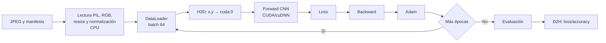

### Diagrama B: paralelismo conceptual

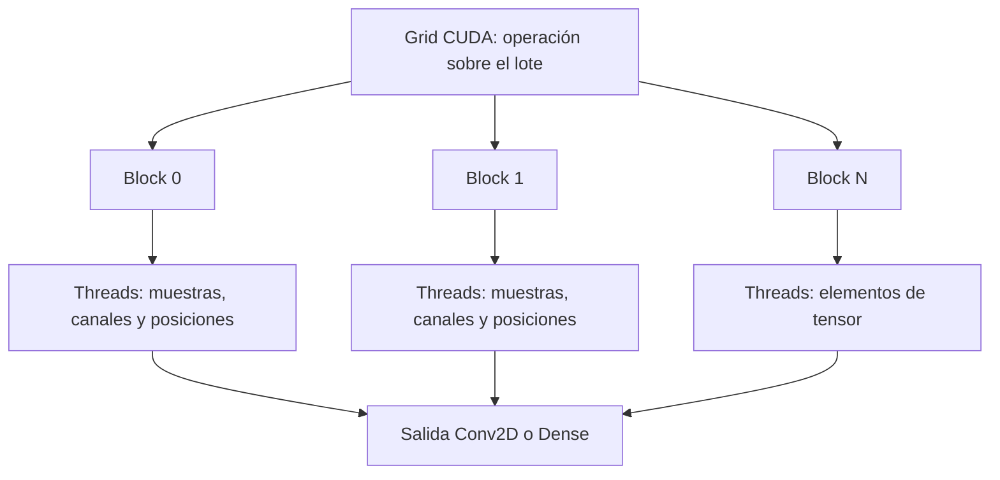

El segundo diagrama es conceptual. PyTorch/cuDNN seleccionan los kernels, grids, blocks, threads, memoria compartida y algoritmos concretos. No se reportan dimensiones internas porque no se ejecutó un profiler que las midiera.

## 4. Implementación técnica

| Función/módulo | Dispositivo o responsabilidad |
|---|---|
| `ASLDataset.__getitem__` | CPU: lectura, RGB, resize, normalización |
| `dataloader.loader` | CPU: DataLoader y lotes |
| `utils.device_for` | Valida CUDA y devuelve `cuda:0` sin fallback |
| `BasicCNN().to(device)` | Coloca parámetros en CPU o CUDA |
| `x.to(device)`, `y.to(device)` | Copias H2D en backend CUDA |
| `execute` | Forward, loss, backward, Adam y checkpoints |
| `evaluate` | Métricas de validation/test |
| `timing.sync/timed` | Sincronización y perf_counter/CUDA Events |
| `evidence.Monitor` | Muestras de CPU, proceso, memoria y nvidia-smi |

El modelo CUDA se verifica con `model_device: cuda:0` e `input_device: cuda:0`. El entrenamiento CPU reporta ambos como `cpu`. En CUDA, la memoria pico registrada por PyTorch fue 204.286 MB.

## 5. Resultados experimentales

### 5.1 Ejecuciones individuales

| Backend | Run | Preprocess (s) | Train (s) | Eval (s) | Total (s) |
|---|---|---:|---:|---:|---:|
| CPU | 1 | 95.034 | 81.340 | 7.744 | 184.259 |
| CPU | 2 | 86.059 | 78.846 | 7.109 | 172.149 |
| CPU | 3 | 85.605 | 77.742 | 7.157 | 170.625 |
| CPU | 4 | 99.365 | 88.011 | 8.600 | 196.125 |
| CPU | 5 | 82.543 | 74.572 | 6.916 | 164.157 |
| CUDA | 1 | 76.489 | 15.510 | 1.012 | 94.334 |
| CUDA | 2 | 76.204 | 15.744 | 2.213 | 95.547 |
| CUDA | 3 | 76.066 | 17.964 | 1.334 | 96.732 |
| CUDA | 4 | 77.469 | 20.346 | 1.427 | 100.715 |
| CUDA | 5 | 77.405 | 19.828 | 1.894 | 100.632 |

### 5.2 Estadísticos y speedup

| Fase | CPU media ± std (s) | CUDA media ± std (s) | Mín–máx CPU (s) | Mín–máx CUDA (s) | Speedup | Reducción |
|---|---:|---:|---:|---:|---:|---:|
| Preprocesamiento | 89.721 ± 7.126 | 76.727 ± 0.666 | 82.543–99.365 | 76.066–77.469 | 1.169× | 14.48% |
| Entrenamiento | 80.102 ± 5.045 | 17.879 ± 2.240 | 74.572–88.011 | 15.510–20.346 | 4.480× | 77.68% |
| Evaluación | 7.505 ± 0.686 | 1.576 ± 0.476 | 6.916–8.600 | 1.012–2.213 | 4.762× | 79.00% |
| Total | 177.463 ± 12.713 | 97.592 ± 2.938 | 164.157–196.125 | 94.334–100.715 | 1.818× | 45.01% |

La fórmula utilizada fue `speedup = media_CPU / media_CUDA`. La reducción fue `100 × (1 - media_CUDA / media_CPU)`.

### 5.3 Transferencias y overhead

| Métrica CUDA | Media |
|---|---:|
| H2D | 1.203 s |
| D2H | 0.0047 s |
| Cómputo CUDA Events | 17.728 s |
| Memoria pico | 204.286 MB |

El residual se calcula como `total - preprocess - train - eval`: CPU `0.134906 s`, CUDA `1.410838 s`. No se atribuye a una única causa. Incluye inicialización, creación de modelo/optimizer/loaders, sincronizaciones, transferencias separadas y límites de instrumentación. Para CUDA, H2D+D2H explican aproximadamente 1.208 s del residual; el resto no está desglosado por una medición independiente.

### 5.4 Gráficas

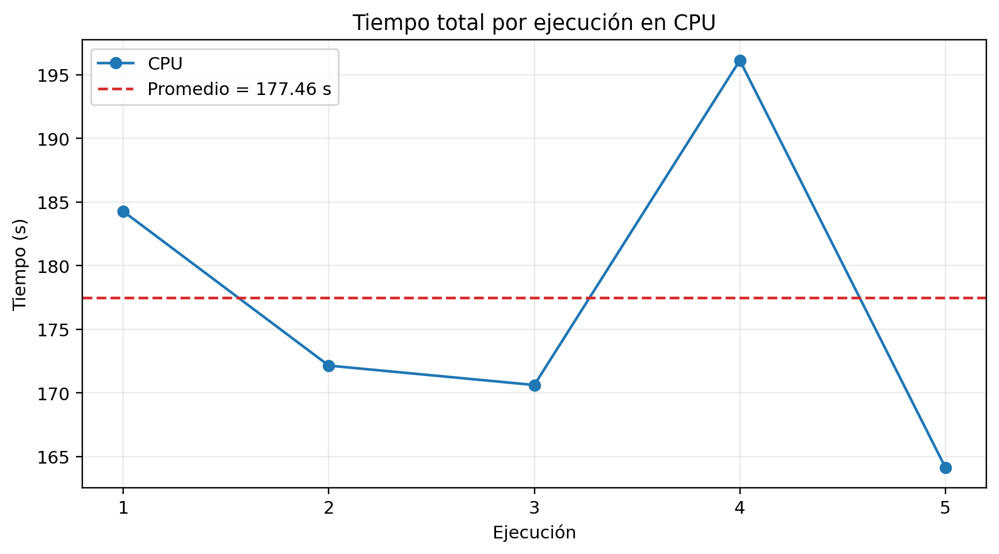

*El tiempo CPU varía entre 164.16 y 196.13 s; la variación se concentra en lectura/preprocesamiento y ejecución CPU.*

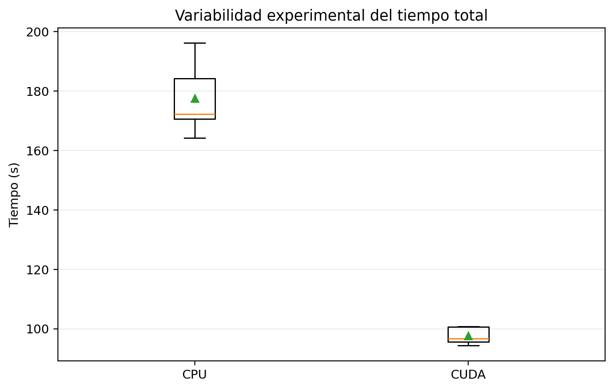

*La distribución muestra menor dispersión total en CUDA que en CPU.*

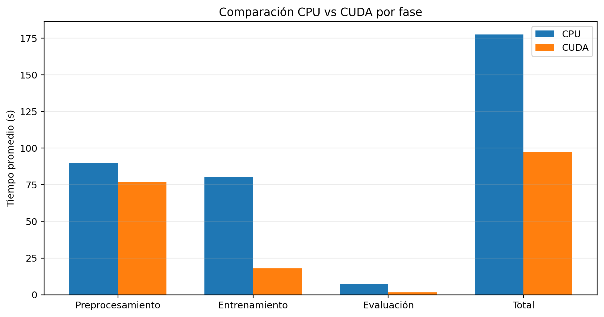

*CUDA reduce principalmente entrenamiento y evaluación; el preprocesamiento permanece cercano al tiempo CPU.*

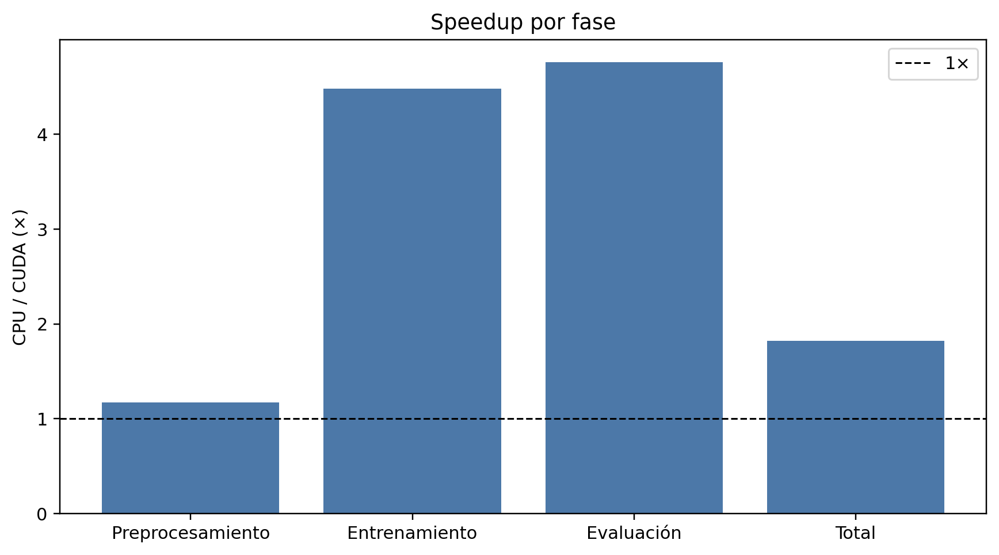

*La línea 1× representa igualdad de tiempo; todas las fases medidas son más rápidas en CUDA.*

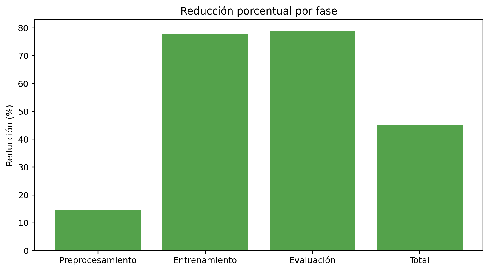

*La mayor reducción es la evaluación, seguida del entrenamiento.*

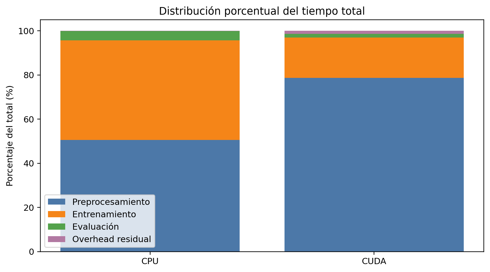

*El preprocessing domina la fracción restante del tiempo CUDA.*

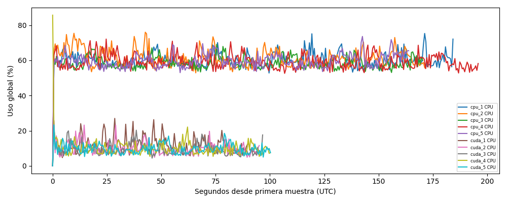

*Gráfica basada en muestras temporales reales del monitor automático. No se interpreta como saturación completa de la GPU.*

Todas las figuras están disponibles también en SVG dentro de `reportes/figuras/`.

## 6. Análisis técnico

### Aceleración y ley de Amdahl

El entrenamiento baja de 80.102 s a 17.879 s, mientras el total baja de 177.463 s a 97.592 s. La diferencia se explica por Amdahl: la parte que permanece en CPU limita el speedup global. El preprocessing representa aproximadamente 50.6% del tiempo CPU y 78.6% del tiempo CUDA según la distribución de fases; por ello no es correcto atribuir todo el beneficio total a los kernels GPU.

### Transferencias y sincronización

Las transferencias H2D promedian 1.203 s y D2H 0.0047 s. Son pequeñas frente al preprocessing, pero forman parte del costo de usar GPU. La sincronización es necesaria porque CUDA ejecuta operaciones de forma asíncrona; sin ella `perf_counter` podría subestimar tiempos.

### Utilización y limitaciones

Task Manager y `nvidia-smi` confirman reconocimiento de la RTX 3050 y actividad del proceso Python. No se afirma saturación: el modelo y los lotes son relativamente pequeños, el preprocessing continúa en CPU y las capturas son instantáneas. En Windows WDDM, algunos campos de memoria por proceso de `nvidia-smi` pueden aparecer como `N/A`; por eso se usa también la memoria reportada por PyTorch.

Las optimizaciones de `pin_memory`, workers, prefetch o caching son oportunidades, no resultados de esta sesión. Cambiarlas requeriría nuevos benchmarks con condiciones documentadas.

## 7. Evidencias de ejecución

### CPU

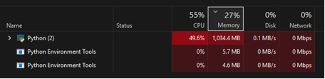

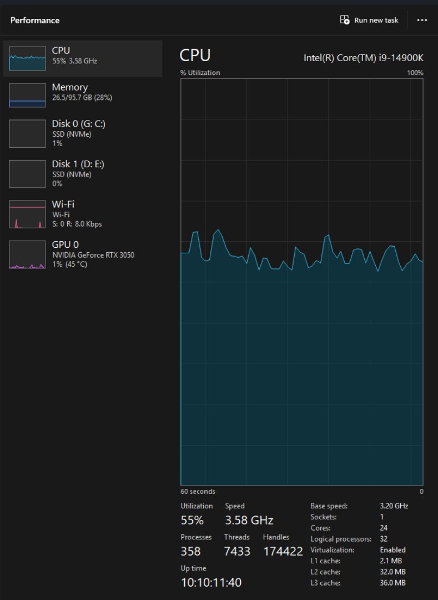

### CUDA

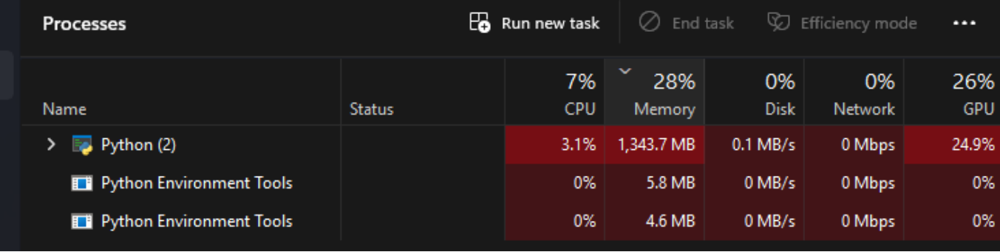

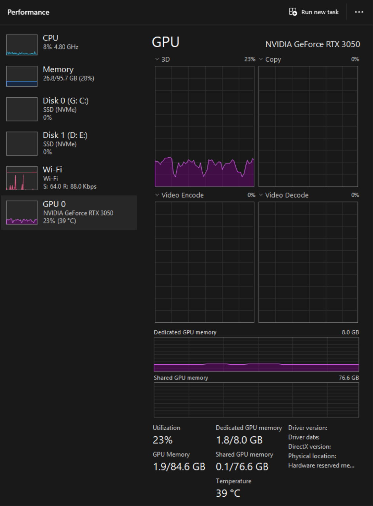

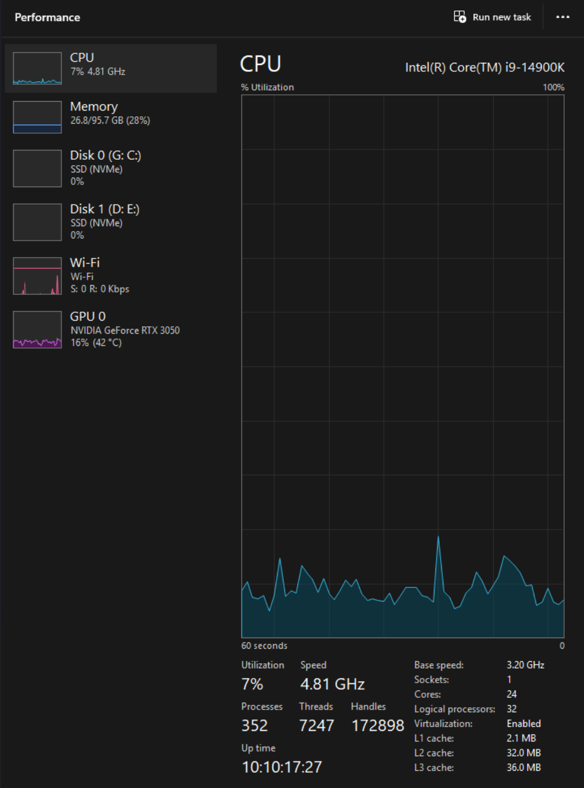

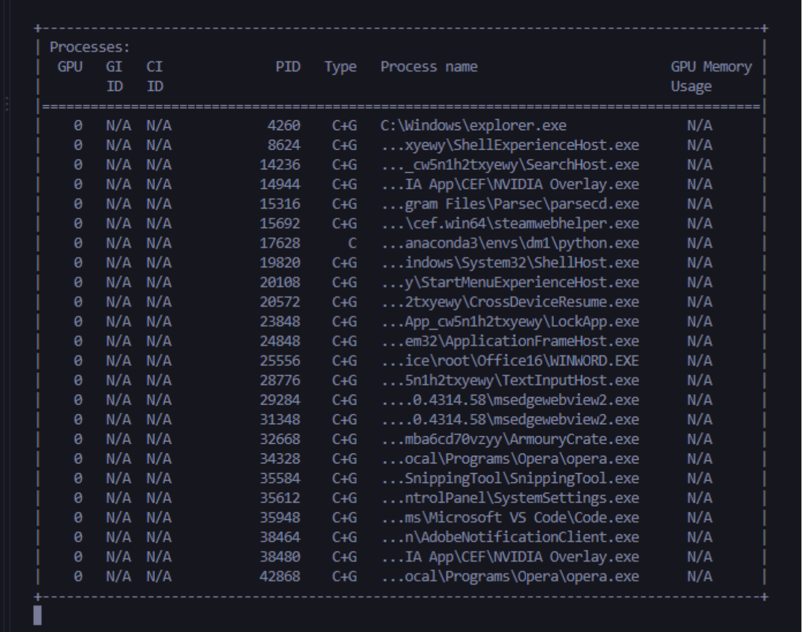

Los CSV temporales se encuentran en `results_fast/evidence/e8ad82b8761d/` y los CSV de resultados en `results_fast/raw/e8ad82b8761d/`.

## 8. Conclusiones

1. La separación CPU/GPU funciona: archivos y preprocessing permanecen en CPU, mientras la CNN se ejecuta en `cuda:0`.
2. CUDA produjo un speedup de 4.480× en entrenamiento y 1.818× en el tiempo total.
3. El cuello de botella principal es el preprocessing CPU, no el cómputo de la CNN.
4. La evidencia confirma el uso de CUDA, pero no demuestra saturación completa de la GPU.
5. La implementación usa PyTorch CUDA/cuDNN y no kernels manuales; debe confirmarse que esto satisface la interpretación del docente de “CUDA Python”.
